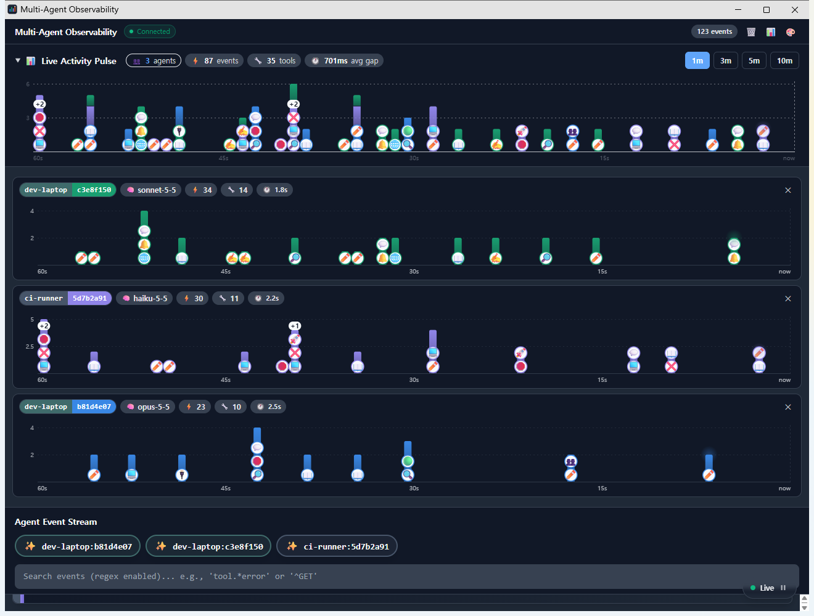
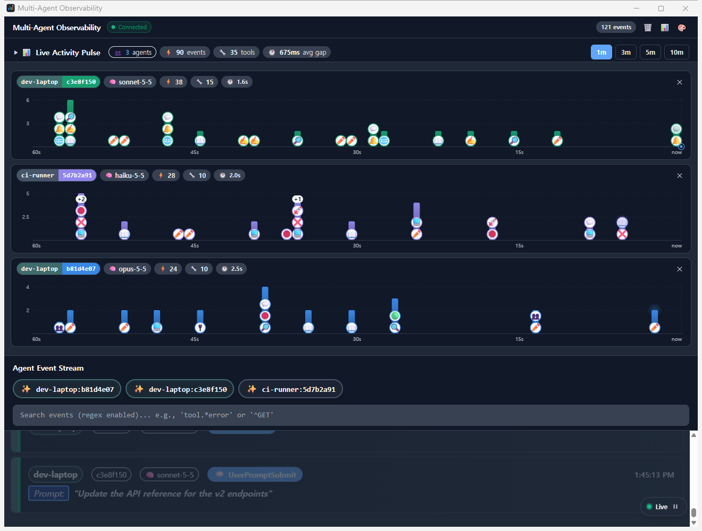

# Multi-Agent Observability Desktop

A Windows desktop skin for **[disler/claude-code-hooks-multi-agent-observability](https://github.com/disler/claude-code-hooks-multi-agent-observability)** — watch every Claude Code session on your PC in one window.

This repository does **not** contain the original project. The installer downloads it from the original author's GitHub (pinned to a tested commit) and applies the changes kept here. All credit for the original observability system goes to [disler](https://github.com/disler).



<sub>Sample data: three sessions on two machines. Each bar is one second; icons show the tools used (❌ = failed call).</sub>

[한국어 안내는 아래에 있습니다](#한국어)

## Thanks, and why this exists

First, thank you to [disler](https://github.com/disler). [claude-code-hooks-multi-agent-observability](https://github.com/disler/claude-code-hooks-multi-agent-observability) is a well-built, widely used project, and everything here stands on it. This is not a replacement — it is my variant of it, and you may well prefer the original.

So why make another one?

- **To see what the AI actually does.** As more of our development runs through AI, more of it happens without us knowing how the agent works. Watching the real stream of prompts, tool calls, subagents and failures has become how I learn what the agent is doing — and how to work with it better. This dashboard is my tool for that.
- **A desktop window, a cleaner look.** I personally don't like keeping a dashboard in a browser tab, so I made it a window of its own, restyled to what I find cleaner and easier to read.
- **To share a good repository.** If this variant helps one more person find the original project, that alone was worth it.

This project is unofficial and not affiliated with Anthropic or the original author.

## What it changes

- **Own window**: the dashboard opens in an Edge app-mode window (no address bar). The event server runs inside it; close the window and everything stops.
- **No Python**: hooks are sent by a small Bun script instead of `uv` + Python, and run asynchronously, so Claude Code never waits on them.
- **Per-session lanes, automatic**: every active session gets its own graph row; the combined "Live Activity Pulse" opens only while nothing is running.
- **Cleaner look**: thin header, compact chips, rounded bars stacked by session color, tool icons stacked on light badges from the bottom of each bar (readable on dark themes), a colorblind-checked session palette, dark theme by default.
- **Clear follow mode**: a "Live" pill while the event list follows new events, "Latest" once you scroll away (click to jump back).



## Requirements

Windows 10/11, [Git](https://git-scm.com/download/win), and [Bun](https://bun.sh) (the installer installs Bun with `npm` if Node.js is present). Microsoft Edge is used for the window (falls back to your default browser).

## Install

### One line (PowerShell)

```powershell
& ([scriptblock]::Create((irm https://raw.githubusercontent.com/BlueBird-0/multi-agent-observability-desktop/main/install.ps1)))
```

Paste it into a PowerShell window. Works with Windows' default execution policy. Add options at the end, e.g. `... ))) -SourceApp my-laptop`.

### From a clone

```powershell
git clone https://github.com/BlueBird-0/multi-agent-observability-desktop
cd multi-agent-observability-desktop
powershell -ExecutionPolicy Bypass -File install.ps1
```

Options: `-InstallDir <path>` (default `%USERPROFILE%\claude-observability`), `-SourceApp <name>` (label shown for this PC, default the computer name).

### What the installer does

1. clones the original project into the install folder and checks out the tested commit,
2. applies `patches/observability-desktop.patch` and copies `desktop/` to `apps/desktop`,
3. runs `bun install` for the server and client,
4. runs `bun apps/desktop/main.ts --install`, which builds the dashboard, adds 12 async hooks to `~/.claude/settings.json` (a timestamped backup is kept; older hooks from the original Python sender are replaced) and creates **Claude Observability** shortcuts on the desktop and in the Start menu.

### Installing with Claude Code (or another AI agent)

You can ask Claude Code: *"Install https://github.com/BlueBird-0/multi-agent-observability-desktop following the README's agent section."* Notes for the agent:

- **Run the installer with the PowerShell tool, not a sandboxed Bash tool.** Claude Code's Bash sandbox on Windows virtualizes `%LOCALAPPDATA%`, so files the installer writes there (launcher script, icon) are invisible to Windows and the desktop shortcut will not start.
- Command: the one-line install above (or `install.ps1` from a clone with `-ExecutionPolicy Bypass`). Pass `-SourceApp <name>` if the user wants a specific label.
- The installer **edits `~/.claude/settings.json`**: it adds 12 async hooks and keeps a timestamped backup. Tell the user before running it. It only replaces hooks that point to `apps/desktop/main.ts` or `send_event.py`; other hooks are left alone.
- Requirements: Git must be installed; Bun is installed with npm when Node.js exists. If neither Bun nor Node.js is present, ask the user to install one rather than guessing.
- Verify (in PowerShell): `Test-Path "$env:LOCALAPPDATA\ClaudeObservability\launch.vbs"` is `True`, and a **Claude Observability** shortcut exists on the desktop. Opening it should make `http://127.0.0.1:4000/events/recent?limit=1` answer while the window is open.
- New hooks take effect in Claude Code sessions immediately; nothing needs restarting.
- Do not run `--uninstall` unless the user asks.

## Use

Open **Claude Observability**. Sessions appear as soon as Claude Code does anything. Events are recorded **only while the window is open** — minimize it to keep recording. Data lives in `%LOCALAPPDATA%\ClaudeObservability`.

You can pin it to the taskbar; the window opens on the pinned button. A pin made with an earlier version opens a second button instead: unpin it and pin it again.

## Uninstall

```powershell
cmd /c bun "%USERPROFILE%\claude-observabilitypps\desktop\main.ts" --uninstall
```

Removes the hooks and shortcuts (history in `%LOCALAPPDATA%\ClaudeObservability` is kept; delete that folder to remove it), then delete the install folder.

## Repository layout

| Path | Content |
|---|---|
| `install.ps1` | Installer |
| `patches/observability-desktop.patch` | Changes to the original client and server |
| `desktop/main.ts` | Window launcher, hook sender, install/uninstall |
| `desktop/assets/` | App icon (PNG and its SVG source page) |

---

## 한국어

이 PC에서 도는 모든 Claude Code 세션을 창 하나에서 실시간으로 보는 도구입니다. **[disler/claude-code-hooks-multi-agent-observability](https://github.com/disler/claude-code-hooks-multi-agent-observability)** 를 Windows 데스크톱용으로 바꾼 것입니다.

이 저장소에는 **원본 코드가 들어 있지 않습니다**. 설치 스크립트가 원작자의 GitHub에서 원본을 받아(시험한 버전에 고정), 여기 있는 변경분만 입힙니다. 원본 관측 시스템의 공은 모두 [disler](https://github.com/disler)에게 있습니다.

### 감사의 말, 그리고 만든 이유

먼저 [disler](https://github.com/disler)에게 감사드립니다. [claude-code-hooks-multi-agent-observability](https://github.com/disler/claude-code-hooks-multi-agent-observability)는 잘 만들어지고 많이 쓰이는 프로젝트이고, 여기 있는 모든 것은 그 위에 서 있습니다. 이 저장소는 원본을 대신하려는 것이 아니라 제 방식으로 고친 변형이며, 원본이 더 맞는 분도 많을 것입니다.

그런데도 새로 만든 이유는 이렇습니다.

- **AI가 실제로 무엇을 하는지 보기 위해서입니다.** AI로 개발하는 일이 늘면서, AI가 어떻게 동작하는지 모른 채 쓰는 방식도 많아졌습니다. 저는 실제 요청, 도구 호출, 서브에이전트, 실패가 흘러가는 모습을 직접 보면서 에이전트가 무엇을 하는지, 어떻게 함께 일해야 하는지를 배우고 있습니다. 이 대시보드는 그 학습 도구입니다.
- **데스크톱 창과 더 깔끔한 화면.** 개인적으로 대시보드를 웹 브라우저 탭에 띄워 두는 것을 좋아하지 않아서, 독립된 창으로 만들고 제 기준에서 더 깔끔하고 읽기 쉬운 디자인으로 바꿨습니다.
- **좋은 저장소를 알리고 싶어서입니다.** 이 변형을 통해 한 명이라도 더 원본 프로젝트를 알게 된다면 그것만으로 의미가 있습니다.

이 프로젝트는 비공식이며 Anthropic이나 원작자와 관련이 없습니다.

### 바뀐 점

- **자체 창**: 대시보드가 Edge 앱 모드 창(주소창 없음)으로 뜹니다. 이벤트 서버가 창과 함께 돌고, 창을 닫으면 모두 종료됩니다.
- **Python 불필요**: 훅을 `uv` + Python 대신 Bun 스크립트로 보내고, 백그라운드로 돌아 Claude Code를 기다리게 하지 않습니다.
- **세션별 그래프 자동 표시**: 활동 중인 세션마다 그래프 한 줄이 생기고, 전체 그래프(Live Activity Pulse)는 아무 세션도 돌지 않을 때만 펼쳐집니다.
- **깔끔한 디자인**: 얇은 상단 줄, 작은 칩, 세션 색으로 쌓은 둥근 막대, 막대 아래쪽부터 흰 배지 위에 쌓은 도구 아이콘(다크 테마에서도 잘 보임), 색약을 고려한 세션 색, 기본 다크 테마.
- **알기 쉬운 자동 스크롤**: 이벤트 목록이 새 이벤트를 따라가는 동안은 "Live", 위로 스크롤하면 "Latest"로 바뀝니다(누르면 최신으로 이동).

화면 예시는 위 영어 안내의 스크린샷을 보세요(예시 데이터: 두 대의 PC에서 도는 세션 3개).

### 필요한 것

Windows 10/11, [Git](https://git-scm.com/download/win), [Bun](https://bun.sh)(Node.js가 있으면 설치 스크립트가 `npm`으로 Bun을 설치). 창은 Microsoft Edge로 띄웁니다(없으면 기본 브라우저).

### 설치

**한 줄 설치 (PowerShell)**

```powershell
& ([scriptblock]::Create((irm https://raw.githubusercontent.com/BlueBird-0/multi-agent-observability-desktop/main/install.ps1)))
```

PowerShell 창에 붙여 넣으면 됩니다. Windows 기본 실행 정책에서도 동작합니다. 옵션은 끝에 붙입니다(예: `... ))) -SourceApp my-laptop`).

**저장소를 받아서 설치**

```powershell
git clone https://github.com/BlueBird-0/multi-agent-observability-desktop
cd multi-agent-observability-desktop
powershell -ExecutionPolicy Bypass -File install.ps1
```

옵션: `-InstallDir <경로>`(기본 `%USERPROFILE%\claude-observability`), `-SourceApp <이름>`(대시보드에 표시할 이 PC 이름, 기본은 컴퓨터 이름).

설치 스크립트가 하는 일:
1. 원본 프로젝트를 설치 폴더에 받고 시험한 커밋으로 맞춥니다.
2. `patches/observability-desktop.patch`를 적용하고 `desktop/`을 `apps/desktop`으로 복사합니다.
3. 서버와 화면의 패키지를 받습니다(`bun install`).
4. `bun apps/desktop/main.ts --install`을 실행합니다. 화면을 빌드하고, `~/.claude/settings.json`에 백그라운드 훅 12개를 넣고(시각이 붙은 백업을 남기며, 원본 Python 훅은 교체), 바탕화면과 시작 메뉴에 **Claude Observability** 바로가기를 만듭니다.

### Claude Code(AI 에이전트)로 설치하기

Claude Code에 이렇게 부탁하면 됩니다: *"https://github.com/BlueBird-0/multi-agent-observability-desktop 를 README의 에이전트 안내대로 설치해 줘."* 에이전트가 지킬 점:

- **설치는 PowerShell 도구로 실행합니다. 샌드박스가 걸린 Bash 도구로 실행하지 않습니다.** Windows에서 Claude Code의 Bash 샌드박스는 `%LOCALAPPDATA%`를 가상화하기 때문에, 설치가 그곳에 만드는 파일(실행 스크립트, 아이콘)이 Windows에서 보이지 않고 바탕화면 바로가기가 실행되지 않습니다.
- 명령: 위의 한 줄 설치(또는 저장소를 받은 뒤 `-ExecutionPolicy Bypass`로 `install.ps1`). 사용자가 원하는 PC 이름이 있으면 `-SourceApp <이름>`을 붙입니다.
- 설치는 **`~/.claude/settings.json`을 수정합니다**(백그라운드 훅 12개 추가, 시각이 붙은 백업 보관). 실행 전에 사용자에게 알립니다. `apps/desktop/main.ts`나 `send_event.py`를 가리키는 훅만 교체하고, 다른 훅은 건드리지 않습니다.
- 필요한 것: Git은 설치되어 있어야 합니다. Bun은 Node.js가 있으면 npm으로 설치됩니다. Bun도 Node.js도 없으면 추측하지 말고 사용자에게 설치를 부탁합니다.
- 확인(PowerShell에서): `Test-Path "$env:LOCALAPPDATA\ClaudeObservability\launch.vbs"`가 `True`이고, 바탕화면에 **Claude Observability** 바로가기가 있어야 합니다. 바로가기로 창을 열면 그동안 `http://127.0.0.1:4000/events/recent?limit=1`이 응답해야 합니다.
- 새 훅은 Claude Code 세션에 바로 적용됩니다. 다시 시작할 것은 없습니다.
- 사용자가 요청하지 않으면 `--uninstall`은 실행하지 않습니다.

### 사용

**Claude Observability**를 엽니다. Claude Code가 무언가를 하는 순간 세션이 나타납니다. 이벤트는 **창이 열려 있는 동안만** 기록됩니다. 계속 기록하려면 창을 최소화해 두세요. 기록은 `%LOCALAPPDATA%\ClaudeObservability`에 있습니다.

작업표시줄에 고정해 쓸 수 있고, 창은 고정한 버튼 위에서 열립니다. 이전 버전으로 고정한 아이콘은 버튼이 하나 더 생기니, 고정을 풀었다가 다시 고정하세요.

### 제거

```powershell
cmd /c bun "%USERPROFILE%\claude-observabilitypps\desktop\main.ts" --uninstall
```

훅과 바로가기를 지웁니다. 기록은 남으니 지우려면 `%LOCALAPPDATA%\ClaudeObservability` 폴더를 지우고, 설치 폴더도 지우면 됩니다.
